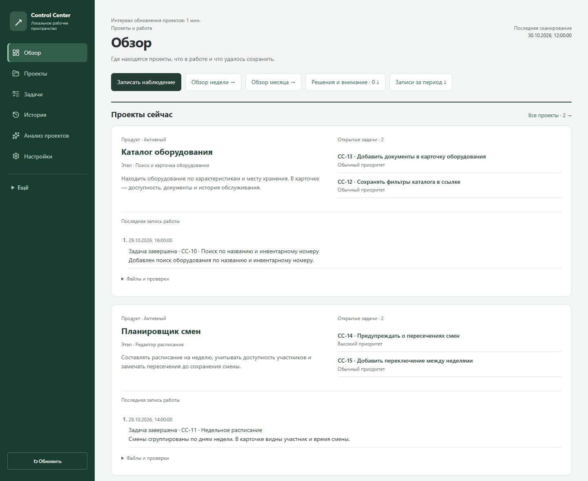
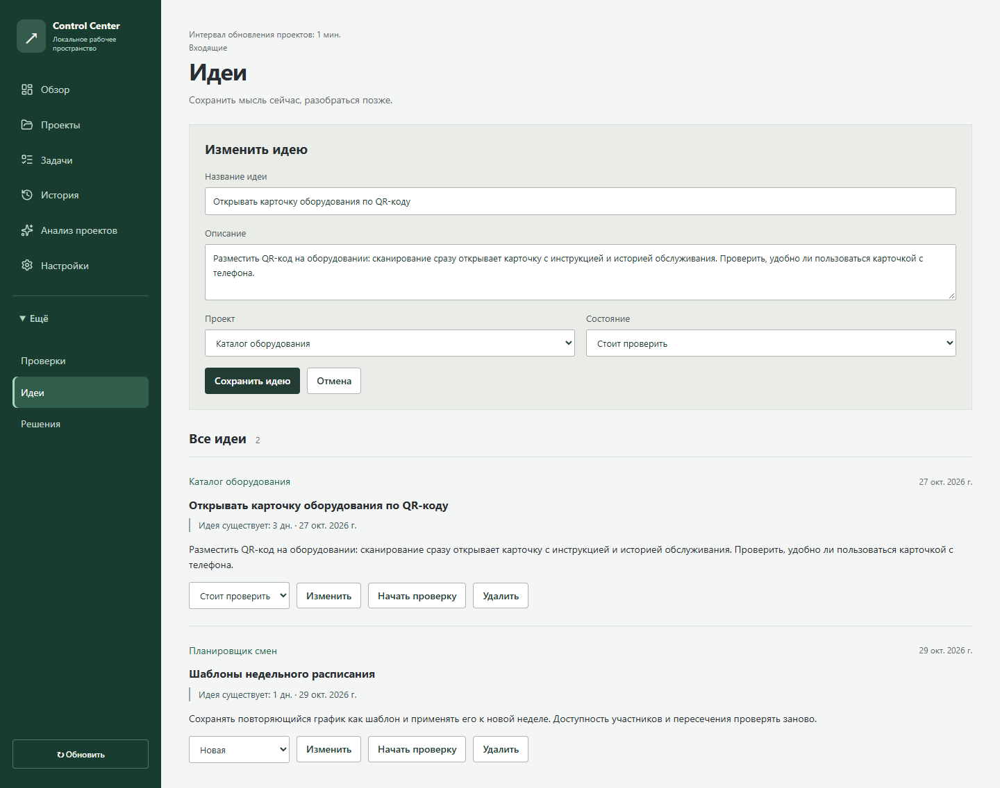

# Control Center

Control Center brings projects, tasks, ideas and results together in one place. It helps you see what is happening across your projects, review completed work and decide what to focus on next.

## What you can do

- Keep an overview of projects, their goals, stages and priorities.
- Create tasks, track completed work and record results.
- Save ideas, observations and decisions alongside the projects they relate to.
- Test ideas and track actions, evidence and conclusions.
- Review a week or month for one project or several projects together.
- Discuss projects with Codex, ask follow-up questions and keep the analysis for later.

Each project page shows its purpose, open tasks, recent work and latest review. A shared history lets you look back across projects.

## Screenshots

### Overview

### Ideas

## Get started

See [setup and usage](SETUP.md#get-started) to get started.
