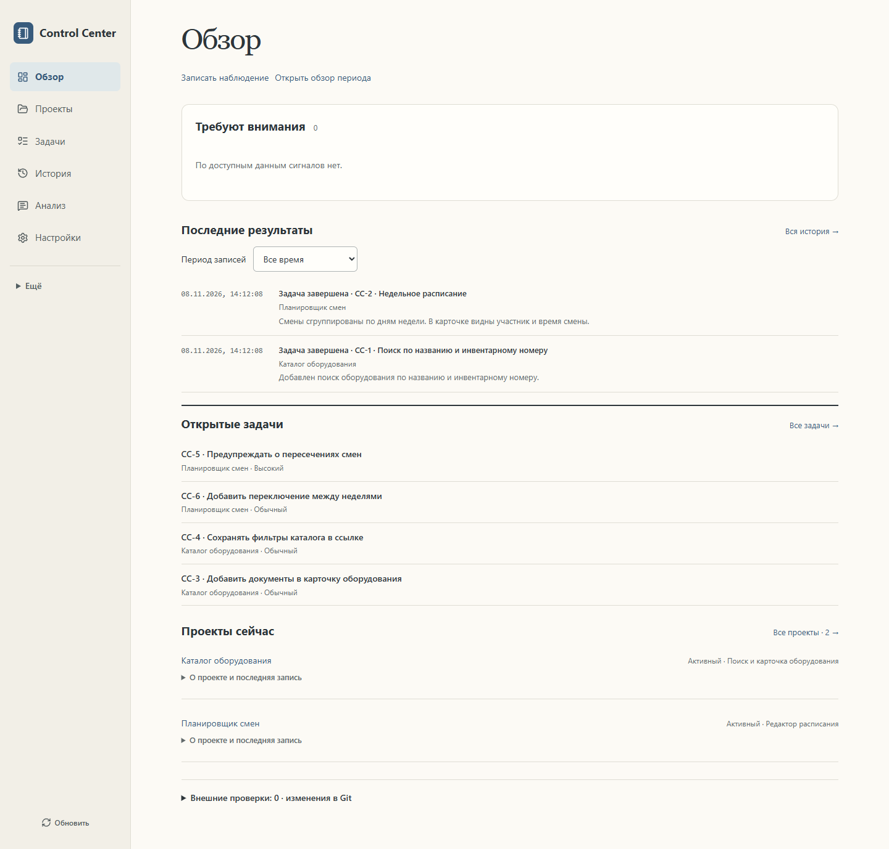
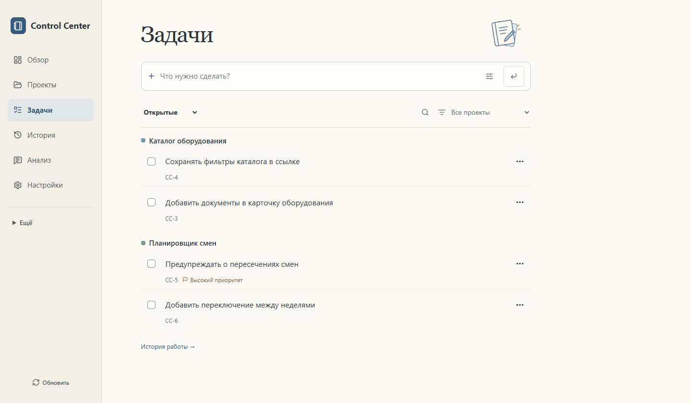
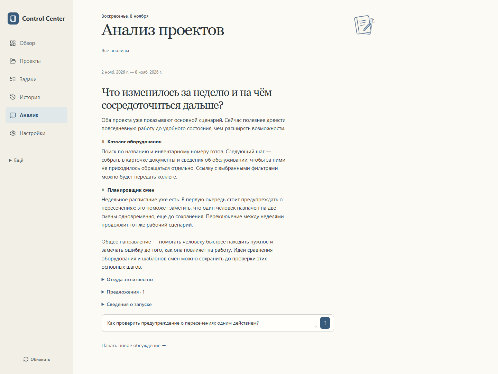

# Control Center

A local workspace for projects, tasks, observations, decisions and weekly or monthly reviews. The interface is in Russian.

## Current workflows

- Discover local repositories and keep a project summary, goal, stage and focus.
- Create numbered tasks, record results, complete or reopen work, and inspect its history.
- Save ideas and observations; read project decisions from their original files.
- Track a question, external actions, evidence and a conclusion in a check.
- Close or return a project. Closing cancels its open tasks while preserving completed results and history.
- Review one or several projects, discuss the prepared context with Codex or use the OpenAI API, and explicitly accept useful proposals.
- Enable separate opt-in weekly/monthly review schedules while the HTTP server is running.

Project pages show their purpose, tasks, history and latest meaningful review. Removing a project from this catalogue does not delete its repository.





## Start

Use Node.js 22.17+ and Git. From the checkout:

```sh
npm ci
npm run dev
```

Open [Control Center](http://127.0.0.1:4310), add project folders in Settings and scan them. [Setup](SETUP.md) covers the Windows shortcut and first connection. [Analysis](guides/ANALYSIS.md) covers context and consent; [maintenance](guides/MAINTENANCE.md) covers storage, recovery, architecture and checks.

The application uses React, TypeScript, Express and SQLite. It runs on loopback; it has no shared user accounts or cloud database sync.
